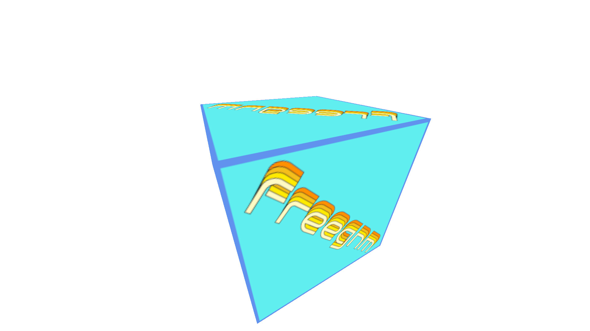
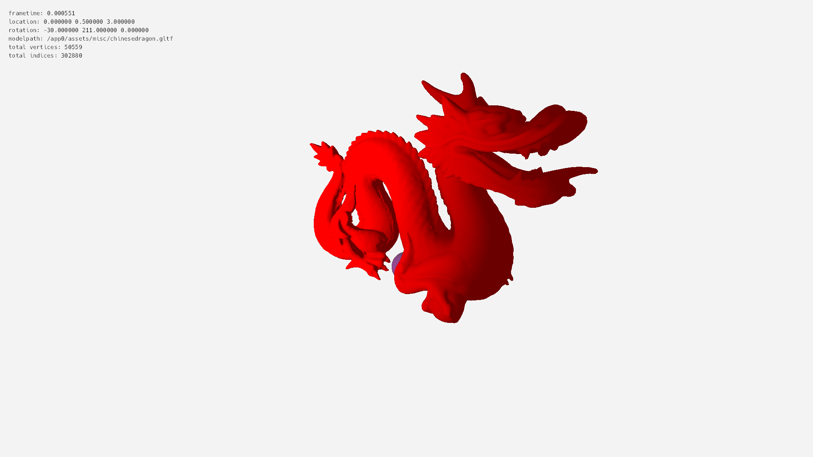
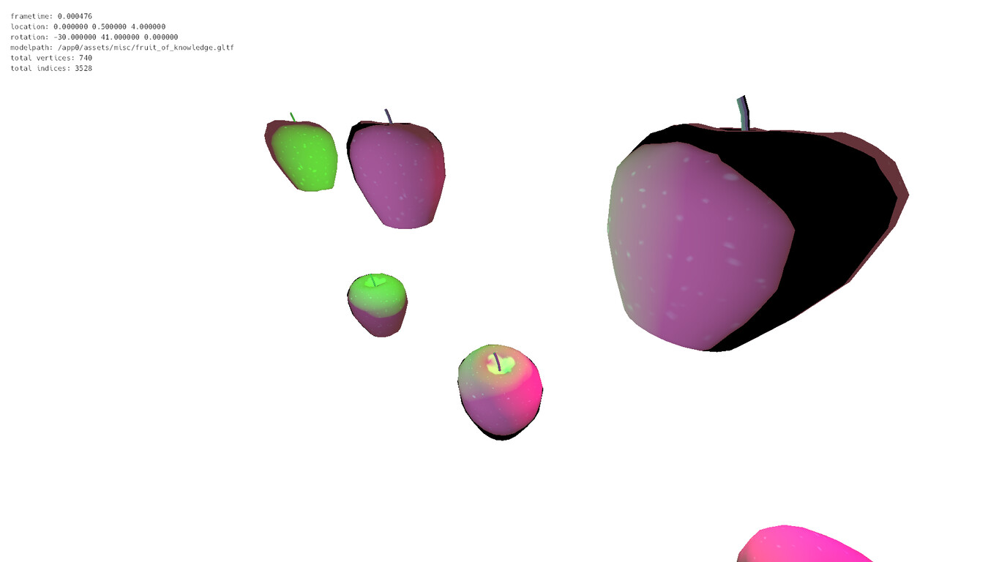

# freegnm-samples

This repository holds demonstrations on how to use [freegnm](https://github.com/lateleite/freegnm): a GPU rendering library for the PlayStation 4, and [psbc](https://github.com/lateleite/psbc): a shader binary compiler for the PlayStation 4.

These samples are meant to be quick and easy to understand.

Want to use the old C examples instead? [Use the 'c' branch](https://github.com/lateleite/freegnm-examples/tree/c)

**CAVEATS:**

- Shader binaries compiled with psbc do not have any reflection information, at least for now.
- None of these examples were tested on a Pro/NEO PS4 and may not work correctly under them.

## Examples available

### Triangle

Very basic example of the GPU's capabilities.


### Cube

Draws a 3D textured cube.



### GLTF

Renders a GLTF's model with some basic PBR parameters.



### Instances

Example of instanced draw calls usage.



### Indirect

Shows how to setup and use indirect draws.


## Building

You need the following tools to build the projects:

- [Zig 0.17.0-dev](https://ziglang.org/download)
- [OpenOrbis Toolchain](https://github.com/OpenOrbis/OpenOrbis-PS4-Toolchain)

Then go this project's root directory and run

```bash
export OO_PS4_TOOLCHAIN=/path/to/OpenOrbis-PS4-Toolchain
zig build
```

If successful, you should find all samples' package files inside the `zig-out` directory.

## References

Some of the samples are based on [Vulkan samples from Sascha Willems](https://github.com/SaschaWillems/Vulkan).

Some PBR algorithms are taken from [Moving Frostbite to Physically Based Rendering](https://seblagarde.files.wordpress.com/2015/07/course_notes_moving_frostbite_to_pbr_v32.pdf).

## Libraries and resources

The following libraries are used:

- [cglm](https://github.com/recp/cglm);
- [cgltf](https://github.com/jkuhlmann/cgltf);
- [stb_image and stb_truetype](https://github.com/nothings/stb).

The following resources are used:

- [Stanford dragon](https://graphics.stanford.edu/data/3Dscanrep) by Stanford Computer Graphics Laboratory;
- [Venus statue](https://github.com/SaschaWillems/Vulkan-Assets) sourced from Sascha Willems;
- [Hack typeface](https://sourcefoundry.org/hack) by SourceFoundry;
- [Bruno Ace typeface](https://github.com/googlefonts/Bruno-ace) by Astigmatic.

All libraries and resources are owned by their respective owners and are not covered by this project's license.

## License

This project is released to the public domain, see [UNLICENSE](UNLICENSE) for more information.
